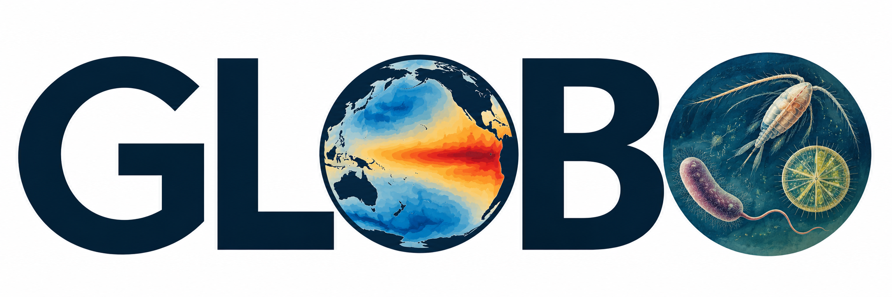
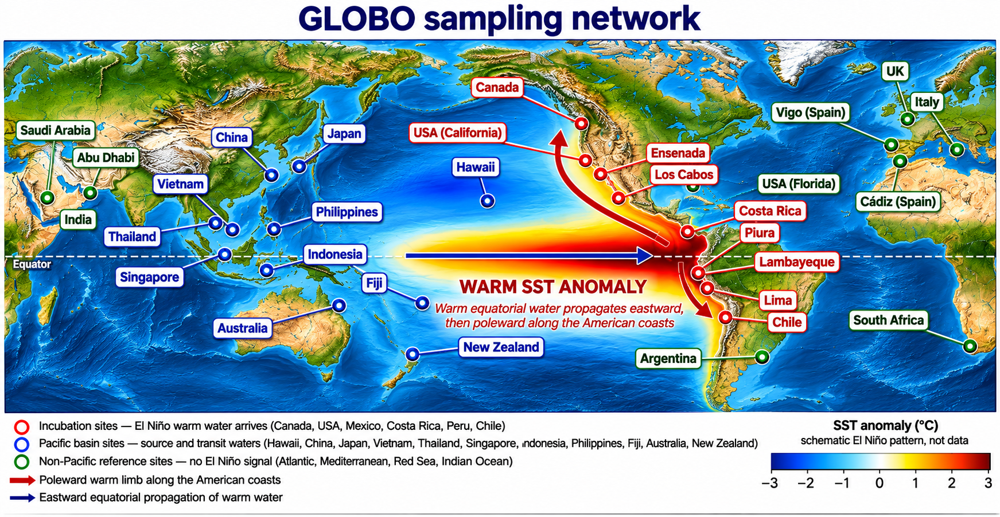

```{=html}
<link rel="stylesheet" href="assets/css/home.css?v=20261124-warm-currents"><a class="skip" href="#main-content">Skip to content</a><header class="site-nav"><a class="brand" href="index.html" aria-label="GLOBO home"></a><div class="coordinator-logos" role="group" aria-label="Coordinating partners"><a class="unige-logo" href="https://distav.unige.it/" title="University of Genoa — DISTAV"></a><a href="https://www.uab.cat/" title="Universitat Autònoma de Barcelona"></a><a href="https://www.stjude.org/" title="St. Jude Children's Research Hospital"></a></div><button class="menu-toggle" aria-expanded="false" aria-controls="main-nav">Menu</button><nav class="nav-links" id="main-nav" aria-label="Main navigation"><a href="index.html" aria-current="page">Home</a><a href="pages/about.html">Project</a><a href="pages/network.html">Network</a><a href="pages/monitoring.html">Monitoring</a><a href="pages/protocol.html">Protocol</a><a href="pages/join.html">Join</a><a href="https://globe-partners.pages.dev/">Partner workspace</a></nav></header><div id="main-content"><section class="hero"><div class="hero-copy"><h1>A Global Initiative to Uncover Ocean Microbiome Responses to Super El Niño in a Warming World.</h1><div class="actions"><a class="btn" href="pages/network.html">Explore the network <span aria-hidden="true">↗</span></a><a class="btn secondary" href="pages/join.html">Join the initiative</a></div></div><div class="logo-currents" data-logo-motion data-motion="loading"><svg class="logo-filter-defs" width="0" height="0" aria-hidden="true" focusable="false"><defs><filter id="globo-warm-currents" x="0" y="0" width="100%" height="100%" color-interpolation-filters="sRGB"><feColorMatrix in="SourceGraphic" type="saturate" values="1.14" result="saturated"/><feComponentTransfer in="saturated" result="warm"><feFuncR type="linear" slope="1.035"/><feFuncG type="linear" slope="0.985"/><feFuncB type="linear" slope="0.985"/></feComponentTransfer><feColorMatrix in="SourceGraphic" type="matrix" values="0 0 0 0 1 0 0 0 0 1 0 0 0 0 1 3 -2 -1 0 -0.15" result="warm-mask"/><feComposite in="warm" in2="warm-mask" operator="in" result="warm-area"/><feComposite in="SourceGraphic" in2="warm-mask" operator="out" result="rest"/><feComposite in="warm-area" in2="rest" operator="arithmetic" k1="0" k2="1" k3="1" k4="0"/></filter></defs></svg><video class="hero-logo-video" style="filter:url(#globo-warm-currents)" autoplay muted loop playsinline preload="auto" poster="assets/images/globo-logo-static.png" width="2172" height="724" aria-hidden="true" tabindex="-1"><source src="assets/videos/globo-logo-currents.webm" type="video/webm"></video><div class="microbe-orbit" aria-hidden="true"><div class="microbe-disc"></div></div></div></section><section class="soft"><div class="wrap network-section"><div class="section-head"><div><p class="section-num">01 / GLOBAL SAMPLING NETWORK</p></div></div><figure class="network-overview"><a href="assets/images/globo-sampling-network.png" aria-label="Open the full-size GLOBO sampling network illustration"></a></figure><p class="network-overview-link"><a href="pages/network.html">Explore the interactive network ↗</a></p></div></section><div class="stats"><div class="stat"><strong data-network-count>30</strong><span>network stations<br>current partner register</span></div><div class="stat"><strong>23</strong><span>participating countries<br>initial project scope</span></div><div class="stat"><strong>4</strong><span>marine regions<br>Pacific · Atlantic · Indian · Mediterranean</span></div></div><section class="wrap"><div class="section-head"><div><p class="section-num">02 / THE INITIATIVE</p><h2>Following marine microbiomes<br>through El Niño.</h2></div><p>Coordinated seawater and plankton sampling will test how microbial communities and their functional potential vary before, during and after El Niño, across regions with different oceanographic responses.</p></div><a href="pages/about.html">About the initiative ↗</a></section><section class="wrap"><p class="section-num">03 / RESEARCH QUESTIONS</p><h2>How do marine microbiomes<br>respond to a changing ocean?</h2><div class="cards"><article class="card"><span class="num">01 / MICROBIAL COMMUNITIES</span><h3>How do microbial communities change?</h3><p>Investigate changes in marine microbial community composition and diversity before and during El Niño, across different ocean regions.</p></article><article class="card"><span class="num">02 / ENVIRONMENT</span><h3>Which conditions are associated with change?</h3><p>Combine coordinated seawater and plankton sampling with environmental monitoring to examine associations between ocean conditions and marine microbiome responses.</p></article><article class="card"><span class="num">03 / MICROBIAL CONTEXT</span><h3>Which functions and microbial groups respond?</h3><p>Use metagenomic sequencing to explore microbial functional potential and selected microbial groups, including <i>Vibrio</i> and potentially pathogenic lineages.</p></article></div></section><section class="wrap"><div class="monitor-band"><div><p class="eyebrow">ENSO & OCEAN MONITORING</p><h2>The oceanographic context<br>behind the samples.</h2><p>Explore NOAA ENSO indices and official outlooks, with a framework for Copernicus Marine environmental data.</p><a class="btn" href="pages/monitoring.html">Open ocean monitoring ↗</a></div><div class="readout"><p class="eyebrow">NOAA CPC / RONI</p><div data-enso-summary>Loading cached index…</div><small>Three-month relative index · °C<br>Not a station temperature or an ENSO advisory.</small></div></div></section><section class="soft"><div class="wrap two-col"><div><p class="section-num">04 / PEOPLE & PARTNERS</p><h2>An international<br>scientific collaboration.</h2><p>GLOBO is a free and independent network of scientists across 23 countries, open to new partners and proposals for coordinated sampling during exceptional ocean events such as El Niño. The Italian Omics Observatory Network participates within this international initiative.</p><a href="pages/people.html">People & partners ↗</a><p style="margin-top:20px"><a class="btn" href="pages/join.html">Join the initiative ↗</a></p></div><div><p class="section-num">05 / NEWS & UPDATES</p><h2>Project updates.</h2>
```

::: {#globo-latest}
:::

```{=html}
<div class="empty">No approved project news has been published yet. Campaign announcements and network updates will appear here.</div><p style="margin-top:20px"><a href="pages/news.html">All news ↗</a></p></div></div></section><script src="assets/js/monitoring.js"></script><script src="assets/js/logo-video.js?v=20261124-warm-currents"></script></div><footer class="site-footer"><div><strong>GLOBO</strong><p>Marine microbiome research.<br>Independent international scientific collaboration.</p></div><p>Project scope: 30 coastal stations · 23 countries<br><a href="pages/news.html">News</a> · <a href="pages/resources.html">Sources & resources</a> · <a href="pages/protocol.html">Sampling protocol</a> · <a href="pages/privacy.html">Privacy & data use</a> · <a href="pages/members.html">Partner workspace</a><br>Independent international scientific collaboration</p></footer><script src="assets/js/site.js?v=20261122-continuous"></script>
```
