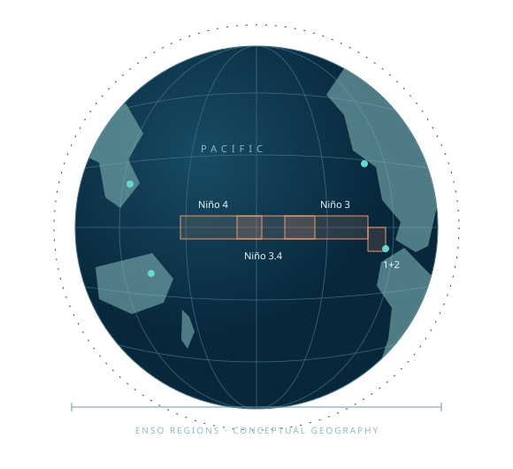

```{=html}
<a class="skip" href="#main-content">Skip to content</a><header class="site-nav"><a class="brand" href="index.html" aria-label="GLOBE home"><svg viewBox="0 0 40 40" fill="none" aria-hidden="true"><circle cx="20" cy="20" r="17" stroke="#64d7ce"/><ellipse cx="20" cy="20" rx="8" ry="17" stroke="#64d7ce"/><path d="M3 20h34M6 12q14 7 28 0M6 28q14-7 28 0" stroke="#64d7ce"/></svg>GLOBE</a><button class="menu-toggle" aria-expanded="false" aria-controls="main-nav">Menu</button><nav class="nav-links" id="main-nav" aria-label="Main navigation"><a href="index.html" aria-current="page">Home</a><a href="pages/about.html">About</a><a href="pages/research.html">Research</a><a href="pages/network.html">Network</a><a href="pages/people.html">People</a><a href="pages/monitoring.html">Monitoring</a><a href="pages/resources.html">Resources</a><a href="pages/news.html">News</a><a href="pages/join.html">Join</a><a href="pages/members.html" class="members">Members</a></nav></header><div id="main-content"><section class="hero"><div class="hero-copy"><p class="eyebrow"><i>Vibrio</i> ecology · El Niño · Global collaboration</p><h1>El Niño, ocean warming<br>and <i>Vibrio</i> dynamics.</h1><p class="lead">A Global Initiative to Uncover Ocean Microbiome Responses to Super El Niño in a Warming World.</p><div class="actions"><a class="btn" href="pages/network.html">Explore the network <span aria-hidden="true">↗</span></a><a class="btn secondary" href="pages/join.html">Join the initiative</a></div></div><div><p class="hero-caption">ENSO study regions. Conceptual illustration, not observed SST.</p></div></section><div class="stats"><div class="stat"><strong>29</strong><span>coastal sampling stations<br>initial project scope</span></div><div class="stat"><strong>23</strong><span>participating countries<br>initial project scope</span></div><div class="stat"><strong>4</strong><span>marine regions<br>Pacific · Atlantic · Indian · Mediterranean</span></div></div><section class="wrap"><div class="section-head"><div><p class="section-num">01 / THE INITIATIVE</p><h2>Understanding <i>Vibrio</i><br>in a changing ocean.</h2></div><p>GLOBE investigates how El Niño reshapes marine microbial communities and whether changing ocean conditions favour the introduction and expansion of pathogenic <i>Vibrio</i> lineages. An international sampling network connects this focus with changes in the wider microbiome and ecosystem functioning.</p></div><a href="pages/about.html">About the initiative ↗</a></section><section class="soft"><div class="wrap"><div class="section-head"><div><p class="section-num">02 / GLOBAL SAMPLING NETWORK</p><h2>Local observations.<br>Connected across oceans.</h2></div><p>A coordinated coastal network spanning the Pacific, Atlantic and Indian oceans and the Mediterranean Sea. Explore approved stations or explicitly select the preliminary demonstration registry.</p></div><link rel="stylesheet" href="assets/vendor/leaflet/leaflet.css"><div class="map-shell" data-network><div class="map-toolbar"><div class="map-mode" role="group" aria-label="Visualization mode"><button type="button" data-mode="network" aria-pressed="true">A · GLOBE network</button><button type="button" data-mode="observed" aria-pressed="false">B · Observed SST anomalies</button></div><label>Registry<select data-registry><option value="approved">Approved stations</option><option value="demo">Demo: approximate starter locations</option></select></label><label class="search-field">Find a station<input data-search type="search" placeholder="Name, country or institution"></label><label>Category<select data-category><option value="">All categories</option></select></label><label>Ocean basin<select data-basin><option value="">All basins</option></select></label><button type="button" data-reset>Reset view</button><label data-date-wrap hidden>Observation date<select data-date></select></label></div><div class="map-canvas" data-map role="region" aria-label="Interactive global sampling network; equivalent station list follows"></div><p class="map-status" data-status role="status">Loading station registry…</p><div class="map-legend" data-legend></div></div><div class="station-list" data-stations aria-label="Station results"></div><noscript>The map requires JavaScript. The <a href="data/stations.csv">approved station registry</a> is also available as CSV.</noscript><script src="assets/vendor/leaflet/leaflet.js"></script><script src="assets/js/network.js"></script><p class="note">The initial project figures are supplied by GLOBE. Verified station coordinates and institutional affiliations are awaiting approval.</p></div></section><section class="wrap"><p class="section-num">03 / RESEARCH QUESTIONS</p><h2>From El Niño conditions<br>to <i>Vibrio</i> dynamics.</h2><div class="cards"><article class="card"><span class="num">01 / VIBRIO</span><h3>How do <i>Vibrio</i> distributions change?</h3><p>Investigate the occurrence and distribution of resident and introduced <i>Vibrio</i> lineages, including pathogenic lineages, before and during El Niño.</p></article><article class="card"><span class="num">02 / ENVIRONMENT</span><h3>Which conditions are associated with change?</h3><p>Combine coordinated seawater and plankton sampling with environmental monitoring to examine associations between ocean conditions and <i>Vibrio</i> dynamics.</p></article><article class="card"><span class="num">03 / MICROBIAL CONTEXT</span><h3>How does the wider microbiome respond?</h3><p>Use metagenomic sequencing and analysis of <i>Vibrio</i> isolates to study these dynamics alongside microbial community diversity and functional potential.</p></article></div></section><section class="wrap"><div class="monitor-band"><div><p class="eyebrow">ENSO & OCEAN MONITORING</p><h2>The oceanographic context<br>behind the samples.</h2><p>Explore NOAA ENSO indices and official outlooks, with a framework for Copernicus Marine environmental data.</p><a class="btn" href="pages/monitoring.html">Open ocean monitoring ↗</a></div><div class="readout"><p class="eyebrow">NOAA CPC / RONI</p><div data-enso-summary>Loading cached index…</div><small>Three-month relative index · °C<br>Not a station temperature or an ENSO advisory.</small></div></div></section><section class="soft"><div class="wrap two-col"><div><p class="section-num">04 / PEOPLE & PARTNERS</p><h2>An international<br>scientific collaboration.</h2><p>GLOBE connects researchers and institutions across 23 countries. The Italian Omics Observatory Network participates within this international initiative.</p><p class="note">The approved institutional directory will be published after partner confirmation. No institutional endorsement is implied by this preview.</p><a href="pages/people.html">People & partners ↗</a><p style="margin-top:20px"><a class="btn" href="pages/join.html">Join the initiative ↗</a></p></div><div><p class="section-num">05 / NEWS & UPDATES</p><h2>Project updates.</h2>
```

::: {#globe-latest}
:::

```{=html}
<div class="empty">No approved project news has been published yet. Campaign announcements and network updates will appear here.</div><p style="margin-top:20px"><a href="pages/news.html">All news ↗</a></p></div></div></section><script src="assets/js/monitoring.js"></script></div><footer class="site-footer"><div><strong>GLOBE</strong><p><i>Vibrio</i> dynamics and ocean microbiome research.<br>International collaboration across a changing ocean.</p></div><p>Project scope: 29 coastal stations · 23 countries<br><a href="pages/resources.html">Sources & resources</a> · <a href="pages/privacy.html">Privacy & data use</a><br>Website release candidate · Project content pending coordinator approval</p></footer><script src="assets/js/site.js"></script>
```
