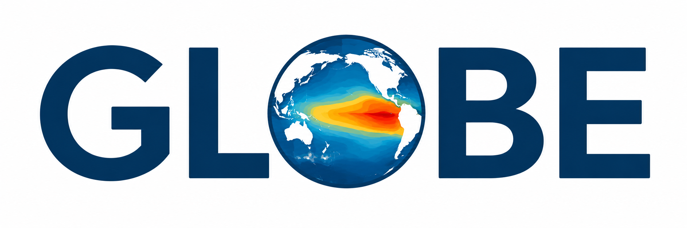

```{=html}
<a class="skip" href="#main-content">Skip to content</a><header class="site-nav"><a class="brand" href="../index.html" aria-label="GLOBE home"></a><button class="menu-toggle" aria-expanded="false" aria-controls="main-nav">Menu</button><nav class="nav-links" id="main-nav" aria-label="Main navigation"><a href="../index.html">Home</a><a href="../pages/about.html">About</a><a href="../pages/research.html">Research</a><a href="../pages/network.html">Network</a><a href="../pages/people.html">People</a><a href="../pages/monitoring.html">Monitoring</a><a href="../pages/resources.html">Resources</a><a href="../pages/news.html">News</a><a href="../pages/join.html" aria-current="page">Join</a><a href="../pages/members.html" class="members">Members</a></nav></header><div id="main-content"><section class="page-intro"><p class="eyebrow">CONTACT GLOBE</p><h1>Join the initiative.</h1><p>Connect with an international network investigating <i>Vibrio</i> dynamics and marine microbial responses to El Niño.</p></section><section class="wrap two-col"><div class="prose"><h2>Contribute to GLOBE</h2><p>We welcome enquiries from researchers and institutions interested in coordinated coastal sampling, oceanographic observations, marine microbiology or scientific collaboration.</p><p>Tell us about your institution, location and proposed contribution. Submitting an enquiry does not automatically register a station or confirm membership.</p><p class="note">Please do not include unpublished results, sensitive sampling details or confidential documents.</p></div><div><form class="join-form" data-join-form><div class="join-fields"><label for="join-name">Full name <span aria-hidden="true">*</span><input id="join-name" name="name" autocomplete="name" maxlength="120" required></label><label for="join-email">Email address <span aria-hidden="true">*</span><input id="join-email" name="email" type="email" autocomplete="email" maxlength="254" required></label><label for="join-institution">Institution / organisation <span aria-hidden="true">*</span><input id="join-institution" name="institution" autocomplete="organization" maxlength="200" required></label><label for="join-country">Country <span aria-hidden="true">*</span><input id="join-country" name="country" autocomplete="country-name" maxlength="100" required></label><label for="join-interest" class="full-field">Proposed contribution <span aria-hidden="true">*</span><select id="join-interest" name="interest" required><option value="">Select an option</option><option>Coastal sampling station</option><option>Environmental monitoring</option><option>Scientific collaboration</option><option>General enquiry</option></select></label><label for="join-message" class="full-field">Message <span aria-hidden="true">*</span><textarea id="join-message" name="message" rows="6" maxlength="4000" required placeholder="Briefly describe your research and how you would like to contribute."></textarea></label></div><label class="join-consent"><input type="checkbox" name="consent" required><span>I agree to be contacted about this enquiry. <a href="privacy.html">Privacy & data use</a>.</span></label><p class="note">Required fields are marked *. This form prepares an email draft; it does not send a message automatically.</p><button class="btn" type="submit">Prepare enquiry</button><p class="note" data-join-status role="status" aria-live="polite">The contact address is awaiting confirmation. You can preview your enquiry; no message will be sent.</p><div class="join-draft" data-join-draft hidden><h3>Your enquiry</h3><pre data-join-text></pre><a class="btn" data-join-mail hidden>Open email draft</a></div><noscript>Contact delivery is awaiting confirmation. JavaScript is needed to prepare an enquiry in this preview.</noscript></form></div></section><script src="../assets/js/contact.js"></script></div><footer class="site-footer"><div><strong>GLOBE</strong><p><i>Vibrio</i> dynamics and ocean microbiome research.<br>International collaboration across a changing ocean.</p></div><p>Project scope: 30 coastal stations · 23 countries<br><a href="../pages/resources.html">Sources & resources</a> · <a href="../pages/privacy.html">Privacy & data use</a><br>Independent international scientific collaboration</p></footer><script src="../assets/js/site.js"></script>
```
