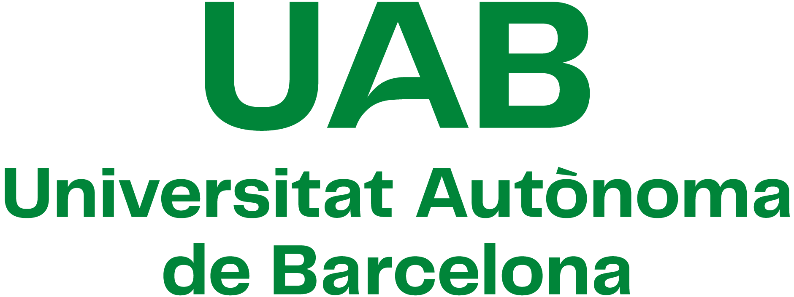

```{=html}
<a class="skip" href="#main-content">Skip to content</a><header class="site-nav"><a class="brand" href="../index.html" aria-label="GLOBE home"></a><div class="coordinator-logos" role="group" aria-label="Coordinating partners"><a class="unige-logo" href="https://distav.unige.it/" title="University of Genoa — DISTAV"></a><a href="https://www.uab.cat/" title="Universitat Autònoma de Barcelona"></a><a href="https://www.stjude.org/" title="St. Jude Children's Research Hospital"></a></div><button class="menu-toggle" aria-expanded="false" aria-controls="main-nav">Menu</button><nav class="nav-links" id="main-nav" aria-label="Main navigation"><a href="../index.html">Home</a><a href="../pages/about.html">Project</a><a href="../pages/network.html">Network</a><a href="../pages/monitoring.html">Monitoring</a><a href="../pages/join.html">Join</a><a href="https://globe-partners.pages.dev/">Partner workspace</a></nav></header><div id="main-content"><section class="page-intro"><p class="eyebrow">MEMBERS AREA</p><h1>Shared work.<br>Controlled access.</h1><p>A dedicated space for authorized GLOBE participants.</p></section><section class="wrap prose"><h2>GLOBE partner workspace</h2><p>Sign in with your authorized email address and the one-time code sent to your inbox.</p><p><a class="btn" href="https://globe-partners.pages.dev/">Open partner workspace</a></p><h2>Coordinate across the network</h2><p>Propose sampling campaigns, request station metadata updates and follow your submissions. Coordinators can review requests across the network.</p><p>For membership enquiries, <a href="join.html">contact the initiative</a>.</p></section></div><footer class="site-footer"><div><strong>GLOBE</strong><p>Marine microbiome research.<br>Independent international scientific collaboration.</p></div><p>Project scope: 30 coastal stations · 23 countries<br><a href="../pages/news.html">News</a> · <a href="../pages/resources.html">Sources & resources</a> · <a href="../pages/privacy.html">Privacy & data use</a> · <a href="../pages/members.html">Partner workspace</a><br>Independent international scientific collaboration</p></footer><script src="../assets/js/site.js?v=20261122-continuous"></script>
```
