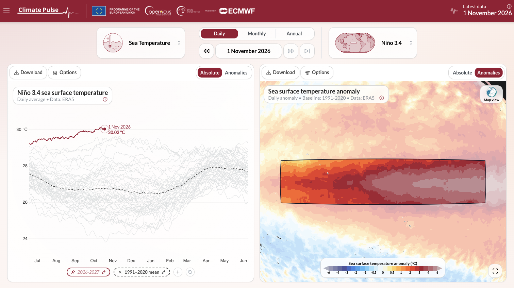

```{=html}
<a class="skip" href="#main-content">Skip to content</a><header class="site-nav"><a class="brand" href="../index.html" aria-label="GLOBE home"></a><div class="coordinator-logos" role="group" aria-label="Coordinating partners"><a href="https://www.uab.cat/" title="Universitat Autònoma de Barcelona"></a><a class="unige-logo" href="https://distav.unige.it/" title="University of Genoa — DISTAV"></a><a href="https://www.stjude.org/" title="St. Jude Children's Research Hospital"></a></div><button class="menu-toggle" aria-expanded="false" aria-controls="main-nav">Menu</button><nav class="nav-links" id="main-nav" aria-label="Main navigation"><a href="../index.html">Home</a><a href="../pages/about.html">Project</a><a href="../pages/network.html">Network</a><a href="../pages/monitoring.html" aria-current="page">Monitoring</a><a href="../pages/join.html">Join</a></nav></header><div id="main-content"><section class="page-intro"><p class="eyebrow">GLOBE OCEAN MONITORING</p><h1>The changing ocean,<br>in context.</h1><p>Cached observations and analyses, official forecasts and transparent data provenance.</p></section><section class="wrap"><section class="card climate-panel" data-climate>
<p class="eyebrow">COPERNICUS / ECMWF · ERA5</p><h2>Daily Niño-region ocean temperatures</h2><p>Explore sea surface temperatures and anomalies using the official ERA5 series distributed for Climate Pulse.</p>
<div class="climate-toolbar"><label>Region<select data-climate-region><option value="nino34">Niño 3.4</option><option value="nino3">Niño 3</option><option value="nino4">Niño 4</option><option value="nino12">Niño 1+2</option></select></label><label>Observation date<input type="date" data-climate-date></label><label>Chart values<select data-climate-quantity><option value="anomaly">SST anomaly</option><option value="absolute">Absolute SST</option></select></label></div>
<div class="climate-stats"><div class="climate-stat" data-climate-stat="date"><small>Observation</small><strong>—</strong><span>Loading date</span></div><div class="climate-stat" data-climate-stat="anomaly"><small>Anomaly</small><strong>—</strong><span>vs 1991–2020</span></div><div class="climate-stat" data-climate-stat="temperature"><small>Temperature</small><strong>—</strong><span>Sea surface temperature</span></div><div class="climate-stat" data-climate-stat="rank"><small>Rank by year</small><strong>—</strong><span>For this calendar date</span></div></div>
<div class="climate-years" data-climate-years></div><div class="climate-chart" data-climate-chart></div><output class="climate-readout" data-climate-readout>Move over the chart for values; click to select a date.</output><p class="metadata" data-climate-status>Loading official ERA5 data…</p><p class="note">Ranks compare the same calendar date across available years; ties share a rank. The dashed line in absolute-temperature view is the 1991–2020 climatology. Daily ERA5 quantities are separate from the seasonal NOAA RONI below.</p>
<details><summary>Data source and sampling notes</summary><p>Data: Copernicus Climate Change Service / ECMWF, ERA5. Visualisation: GLOBE. <a data-climate-source href="https://pulse.climate.copernicus.eu/">Official source CSV</a> · <a href="https://doi.org/10.24381/cds.adbb2d47">ERA5 dataset</a></p><pre data-climate-notes style="white-space:pre-wrap;font-size:12px"></pre></details>
<details class="official-figures"><summary>Official Climate Pulse release figures</summary><p>Original C3S/ECMWF figures published on 10 November 2026. The observation date is printed within each image.</p><p><a href="../assets/images/copernicus/nino34.png" target="_blank" rel="noopener"></a></p><p><a href="../assets/images/copernicus/nino3.png">Niño 3</a> · <a href="../assets/images/copernicus/nino4.png">Niño 4</a> · <a href="../assets/images/copernicus/nino12.png">Niño 1+2</a></p></details>
</section><div style="height:28px"></div><div class="two-col"><article class="card"><p class="eyebrow">NOAA CPC / RONI · ANALYSIS</p><div data-enso-summary>Loading cached index…</div><p class="note">The latest seasonal index is not an ENSO alert. Consult the official diagnostic discussion for the coupled ocean–atmosphere assessment.</p></article><article class="card"><p class="eyebrow">OFFICIAL ENSO ASSESSMENT & FORECAST</p><h3>NOAA Climate Prediction Center</h3><p>Read the dated advisory and outlook directly from NOAA. Forecast probabilities are not reproduced without a verified issue date.</p><a href="https://www.cpc.ncep.noaa.gov/products/analysis_monitoring/enso_advisory/ensodisc.html">Diagnostic discussion ↗</a><br><a href="https://www.cpc.ncep.noaa.gov/products/analysis_monitoring/enso/roni/probabilities/">Official ENSO probabilities ↗</a><br><a href="https://www.cpc.ncep.noaa.gov/products/analysis_monitoring/enso/roni/outlook/">Official RONI outlook ↗</a></article></div><div class="card" style="margin-top:24px"><h2>Historical relative Niño index</h2><label>Time window <select data-years><option value="3">Recent 3 years</option><option value="10">Recent 10 years</option><option value="100">All cached years</option></select></label><label>Chart view <select data-enso-view><option value="timeline">Continuous timeline</option><option value="comparison">Compare years</option></select></label><div class="chart-years" data-enso-years hidden></div><div data-enso-chart></div><output class="chart-probe" data-enso-probe aria-live="polite">Move over the chart to inspect a season.</output><button type="button" class="chart-export" data-enso-export>Download chart (SVG)</button><p class="metadata" data-enso-meta></p><details><summary>Accessible index table</summary><div class="table-scroll" data-enso-table></div></details></div><div class="prose"><h2>Explore Copernicus Climate Pulse</h2><p>Explore the official C3S/ECMWF application for ERA5 sea surface temperatures, anomalies and Niño-region comparisons. These ERA5 analyses have their own definitions and are separate from NOAA RONI shown here.</p><p><a class="btn" href="https://pulse.climate.copernicus.eu/" target="_blank" rel="noopener noreferrer">Open Climate Pulse ↗</a></p><p class="metadata"><a href="https://climate.copernicus.eu/new-version-climate-pulse-provides-new-monitoring-el-nino-conditions">About Climate Pulse 2.0 and its ENSO monitoring</a> · Copernicus Climate Change Service, implemented by ECMWF.</p><h2>Index definitions</h2><p>RONI is a three-month running mean of relative Niño 3.4 SST anomalies, accounting for tropical-mean warming. NOAA adopted it operationally in February 2026. The current CPC RONI page describes ERSSTv6 and a 1991–2020 reference period; the cache retains its source and definition. Recent values may be revised.</p><p>Historical ONI uses a different definition and historically changing reference periods. RONI, ONI and weekly Niño indices are not interchangeable. The NOAA index chart shows RONI; the daily ERA5 temperature panel is a separate analysis. No event classification is inferred from a single value.</p><h2>SST and SST anomalies</h2></div><link rel="stylesheet" href="../assets/vendor/leaflet/leaflet.css"><div class="map-shell" data-network><div class="map-toolbar"><label>Map view<select data-map-view><option value="network">Station network</option><option value="observed">SST anomalies</option></select></label><select data-registry hidden aria-label="Station register"><option value="network">Network stations</option></select><label class="search-field">Find a station<input data-search type="search" placeholder="Name, country or institution"></label><label>Category<select data-category><option value="">All categories</option></select></label><label>Ocean basin<select data-basin><option value="">All basins</option></select></label><button type="button" data-reset>Reset view</button><label data-date-wrap hidden>Observation date<select data-date></select></label></div><div class="map-canvas" data-map role="region" aria-label="Interactive global sampling network; equivalent station list follows"></div><p class="map-status" data-status role="status">Loading station registry…</p><div class="map-legend" data-legend></div></div><div class="station-list" data-stations aria-label="Station results"></div><noscript>The map requires JavaScript. The <a href="../data/stations.csv">approved station registry</a> is also available as CSV.</noscript><script src="../assets/vendor/leaflet/leaflet.js"></script><script src="../assets/js/network.js"></script><div class="prose"><h2>Copernicus Marine</h2><p>The initial product selection is <a href="https://data.marine.copernicus.eu/product/SST_GLO_SST_L4_NRT_OBSERVATIONS_010_001/description">Global Ocean OSTIA Sea Surface Temperature and Sea Ice Analysis</a>: daily Level 4 foundation SST at 0.05° resolution. It is a satellite and in-situ analysis, not a direct measurement at each station.</p><p>Coastal land masks, grid-cell distance, analysis uncertainty and the difference between foundation SST and sampling-depth temperatures must be checked for each station. Historical products need explicit temporal coverage and consistent processing. No station values are displayed before these checks.</p><h2>Sources and timestamps</h2><p>The cache records the observation period and the last successful data retrieval separately. Cached data can become stale; retrieval time is not an observation date. The platform uses near-real-time products where available and distinguishes analyses from official forecasts.</p><p><a href="https://www.cpc.ncep.noaa.gov/products/analysis_monitoring/enso/roni/">NOAA RONI definition</a> · <a href="https://www.coralreefwatch.noaa.gov/product/5km/">NOAA Coral Reef Watch</a> · <a href="https://marine.copernicus.eu/">Copernicus Marine</a></p></div></section><script src="../assets/js/monitoring.js"></script><script src="../assets/js/climate.js"></script></div><footer class="site-footer"><div><strong>GLOBE</strong><p>Marine microbiome research.<br>Independent international scientific collaboration.</p></div><p>Project scope: 30 coastal stations · 23 countries<br><a href="../pages/news.html">News</a> · <a href="../pages/resources.html">Sources & resources</a> · <a href="../pages/privacy.html">Privacy & data use</a> · <a href="../pages/members.html">Partner workspace</a><br>Independent international scientific collaboration</p></footer><script src="../assets/js/site.js?v=20261122-continuous"></script>
```
