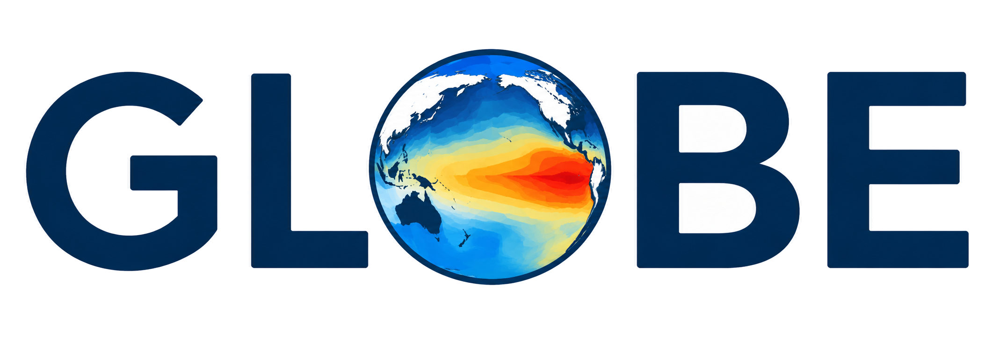

```{=html}
<a class="skip" href="#main-content">Skip to content</a><header class="site-nav"><a class="brand" href="../index.html" aria-label="GLOBE home"></a><div class="coordinator-logos" role="group" aria-label="Coordinating partners"><a href="https://www.uab.cat/" title="Universitat Autònoma de Barcelona"></a><a class="distav-logo" href="https://distav.unige.it/" title="DISTAV — University of Genoa"></a><a href="https://www.stjude.org/" title="St. Jude Children's Research Hospital"></a></div><button class="menu-toggle" aria-expanded="false" aria-controls="main-nav">Menu</button><nav class="nav-links" id="main-nav" aria-label="Main navigation"><a href="../index.html">Home</a><a href="../pages/about.html">Project</a><a href="../pages/network.html" aria-current="page">Network</a><a href="../pages/monitoring.html">Monitoring</a><a href="../pages/join.html">Join</a></nav></header><div id="main-content"><section class="page-intro"><p class="eyebrow">PEOPLE & PARTNERS</p><h1>An international research network.</h1><p>Researchers and institutions contribute local expertise to an initiative focused on <i>Vibrio</i> dynamics and marine microbial responses to El Niño.</p></section><section class="wrap"><div class="two-col"><div><h2>Participating institutions</h2><p>The initiative initially spans 23 countries. Institutional names, websites and participant profiles will be added from the approved partner registry.</p><p>The Italian Omics Observatory Network is one participant within GLOBE.</p></div><div class="empty"><h3>Directory awaiting confirmation</h3><p>No coordinators, affiliations or contact details have been invented. Partner approval is required before publication.</p></div></div><div class="prose"><h2>Join the initiative</h2><p>Interested in contributing a coastal sampling station, environmental observations or scientific expertise? <a href="join.html">Contact the GLOBE team</a>.</p></div></section></div><footer class="site-footer"><div><strong>GLOBE</strong><p><i>Vibrio</i> dynamics and ocean microbiome research.<br>International collaboration across a changing ocean.</p></div><p>Project scope: 30 coastal stations · 23 countries<br><a href="../pages/news.html">News</a> · <a href="../pages/resources.html">Sources & resources</a> · <a href="../pages/privacy.html">Privacy & data use</a> · <a href="../pages/members.html">Partner workspace</a><br>Independent international scientific collaboration</p></footer><script src="../assets/js/site.js"></script>
```
