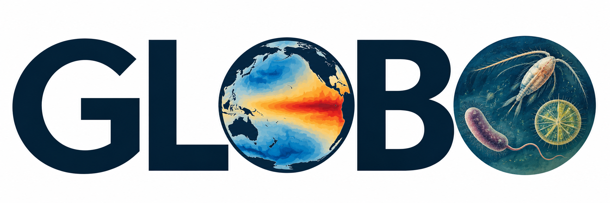

```{=html}
<a class="skip" href="#main-content">Skip to content</a><header class="site-nav"><a class="brand" href="../index.html" aria-label="GLOBO home"></a><div class="coordinator-logos" role="group" aria-label="Coordinating partners"><a class="unige-logo" href="https://distav.unige.it/" title="University of Genoa — DISTAV"></a><a href="https://www.uab.cat/" title="Universitat Autònoma de Barcelona"></a><a href="https://www.stjude.org/" title="St. Jude Children's Research Hospital"></a></div><button class="menu-toggle" aria-expanded="false" aria-controls="main-nav">Menu</button><nav class="nav-links" id="main-nav" aria-label="Main navigation"><a href="../index.html">Home</a><a href="../pages/about.html">Project</a><a href="../pages/network.html">Network</a><a href="../pages/monitoring.html">Monitoring</a><a href="../pages/protocol.html">Protocol</a><a href="../pages/join.html">Join</a><a href="https://globe-partners.pages.dev/">Partner workspace</a></nav></header><div id="main-content"><section class="page-intro"><p class="eyebrow">PRIVACY & DATA USE</p><h1>Public metadata,<br>with clear boundaries.</h1><p>The public site excludes private contact details and unpublished scientific datasets.</p></section><section class="wrap prose"><h2>Public data</h2><h2>Contact enquiries</h2><p>Join uses Cloudflare Turnstile to check submissions and stores accepted enquiries in the private coordination workspace. Email notifications are sent through the project’s authorized Google service to its coordination group. Workspace access follows the coordinator and designated-reviewer permissions; email access follows the Google group membership. The public website does not publish enquiries or add stations. No attachments are requested. If the online service is unavailable, the manual contact link opens your email application.</p><h2>External services</h2><p>The map requests ocean basemap tiles from Esri/ArcGIS. Your browser sends standard connection information, including your IP address, to that provider. Cloudflare processes the form’s spam verification and Google processes email notifications. External NOAA and Copernicus links open their own services. The public website does not use analytics or advertising cookies. Partner authentication is provided separately through Cloudflare Access.</p><h2>Before public launch</h2><p>The responsible institution must confirm the data controller, privacy contact, retention policies and applicable institutional privacy notice. Approved contact details will be added before public launch.</p></section></div><footer class="site-footer"><div><strong>GLOBO</strong><p>Marine microbiome research.<br>Independent international scientific collaboration.</p></div><p>Project scope: 30 coastal stations · 23 countries<br><a href="../pages/news.html">News</a> · <a href="../pages/resources.html">Sources & resources</a> · <a href="../pages/protocol.html">Sampling protocol</a> · <a href="../pages/privacy.html">Privacy & data use</a> · <a href="../pages/members.html">Partner workspace</a><br>Independent international scientific collaboration</p></footer><script src="../assets/js/site.js?v=20261122-continuous"></script>
```
