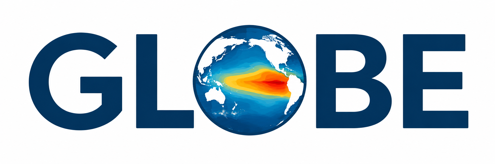

```{=html}
<a class="skip" href="#main-content">Skip to content</a><header class="site-nav"><a class="brand" href="../index.html" aria-label="GLOBE home"></a><button class="menu-toggle" aria-expanded="false" aria-controls="main-nav">Menu</button><nav class="nav-links" id="main-nav" aria-label="Main navigation"><a href="../index.html">Home</a><a href="../pages/about.html">About</a><a href="../pages/research.html">Research</a><a href="../pages/network.html">Network</a><a href="../pages/people.html">People</a><a href="../pages/monitoring.html">Monitoring</a><a href="../pages/resources.html" aria-current="page">Resources</a><a href="../pages/news.html">News</a><a href="../pages/join.html">Join</a><a href="../pages/members.html" class="members">Members</a></nav></header><div id="main-content"><section class="page-intro"><p class="eyebrow">PUBLICATIONS & RESOURCES</p><h1>Methods, evidence<br>and shared resources.</h1><p>Approved publications and public research materials from the GLOBE initiative.</p></section><section class="wrap prose"><h2>Project publications</h2>
```

::: {#globe-publications}
:::

```{=html}
<div class="empty">No approved GLOBE publications have been added. This section will include author lists, publication dates, journal information and DOI links.</div><h2>Ocean monitoring sources</h2><p><a href="https://www.cpc.ncep.noaa.gov/products/analysis_monitoring/enso/roni/">NOAA CPC ENSO indices and definitions</a><br><a href="https://www.coralreefwatch.noaa.gov/product/5km/">NOAA Coral Reef Watch SST products</a><br><a href="https://data.marine.copernicus.eu/products">Copernicus Marine catalogue</a></p><h2>Public station register</h2><p><a href="../data/stations.csv">Approved station CSV</a> · <a href="../data/stations.geojson">Approved station GeoJSON</a></p><p>The approved register is empty until verified station information is supplied.</p><h2>Protocols and internal materials</h2><p>Internal protocols and unpublished reports will be available only through the independently authenticated Members Area. They are not included in this public website.</p></section></div><footer class="site-footer"><div><strong>GLOBE</strong><p><i>Vibrio</i> dynamics and ocean microbiome research.<br>International collaboration across a changing ocean.</p></div><p>Project scope: 30 coastal stations · 23 countries<br><a href="../pages/resources.html">Sources & resources</a> · <a href="../pages/privacy.html">Privacy & data use</a><br>Independent international scientific collaboration</p></footer><script src="../assets/js/site.js"></script>
```
